<div align="center">

# ModelOps Control Plane

**Canary rollouts for ML models, decided by statistics instead of guesswork.**

A new model version earns production traffic one step at a time. Every step is
tested against the stable version on latency, errors *and* prediction quality,
with confidence intervals. The rollout is promoted, rolled back or frozen for a
human on its own, and every decision is explained in plain English.

[](https://github.com/negativexq/modelops-control-plane/actions/workflows/ci.yml)


[](LICENSE)

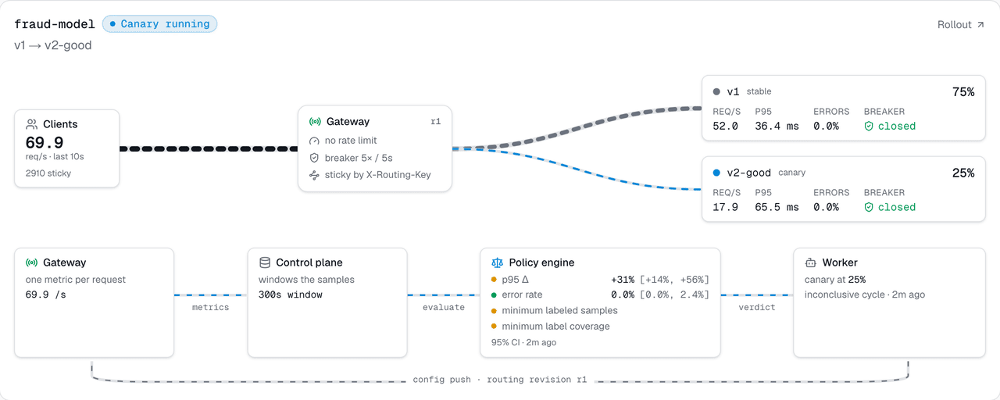

<sub>The Gateway page during a live rollout. Beam width is each version's share of traffic, speed is its request rate. Below it, the control loop that moves the split.</sub>

</div>

---

## Contents

- [What it does](#what-it-does)
- [A tour of the dashboard](#a-tour-of-the-dashboard)
- [How it works](#how-it-works)
- [Quickstart](#quickstart)
- [Five-minute demo](#five-minute-demo)
- [Benchmarks](#benchmarks)
- [Feature reference](#feature-reference)
- [Development](#development)
- [Known limitations](#known-limitations)
- [Production evolution](#production-evolution)
- [Troubleshooting](#troubleshooting)

## What it does

| | |
|---|---|
| 🚦 **Ramps traffic gradually** | A canary climbs `10% → 25% → 50%`, one tested step at a time, and a pass at 50% promotes it, through a real gateway with sticky routing, a circuit breaker per version and rate limits. |
| 📐 **Decides with statistics** | Error rate, p95 latency and recall each come with a confidence interval and a p-value. A check fails only when the whole interval is past the limit, so two unlucky requests can't roll back a good model. |
| 🏷️ **Judges quality, not just uptime** | Ground-truth labels arrive late and incomplete, through a real ingestion API. Quality checks wait for a matured window and enough positive examples before they speak. |
| 🤖 **Acts on its own, explains itself** | A worker promotes, rolls back or freezes the rollout for a human. Every check writes a sentence saying why, and the timeline tells the whole story. |
| 🔁 **Heals drift** | The database holds the desired traffic split, the router holds the observed one. A reconciler repairs any difference, even after the router restarts and forgets everything. |
| 🔭 **Observable end to end** | Prometheus metrics on every service, Grafana dashboards with alerts, and an OpenTelemetry trace for every prediction from the gateway down to the model's inference. |

It all runs with one `docker compose up` on a 16 GB laptop: 9 ModelOps containers
plus Prometheus, Grafana and Jaeger.

## A tour of the dashboard

### Overview

What the control loop is doing right now, what it decided recently, and how much
of that was automatic.

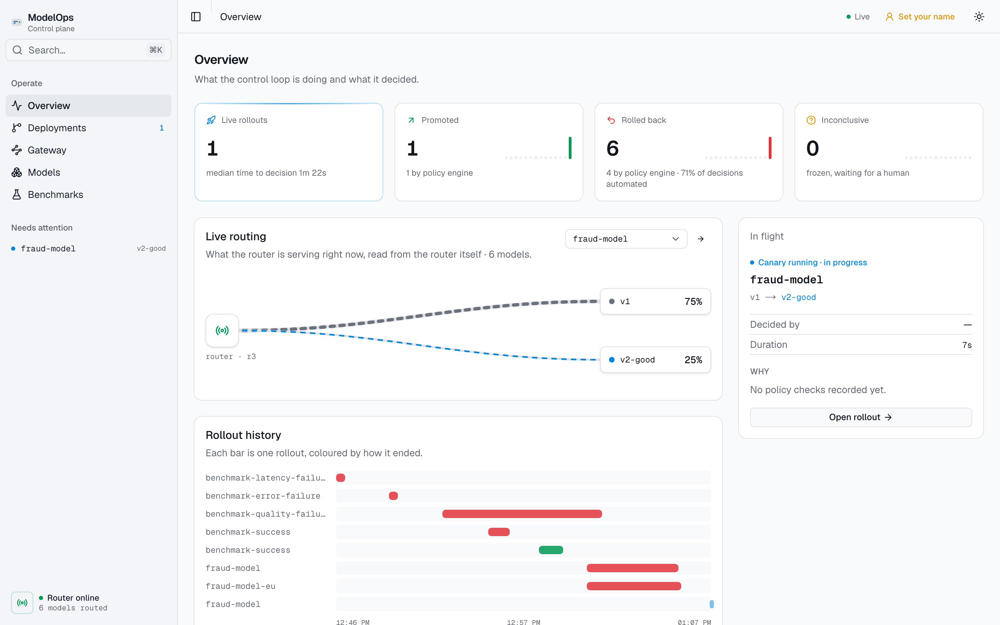

### Gateway

Every prediction's path through the router, live: clients, the gateway's rate
limit, sticky routing and per-version circuit breaker, then the control loop that
measures the split and moves it. Line width is the traffic share, dash speed the
request rate.

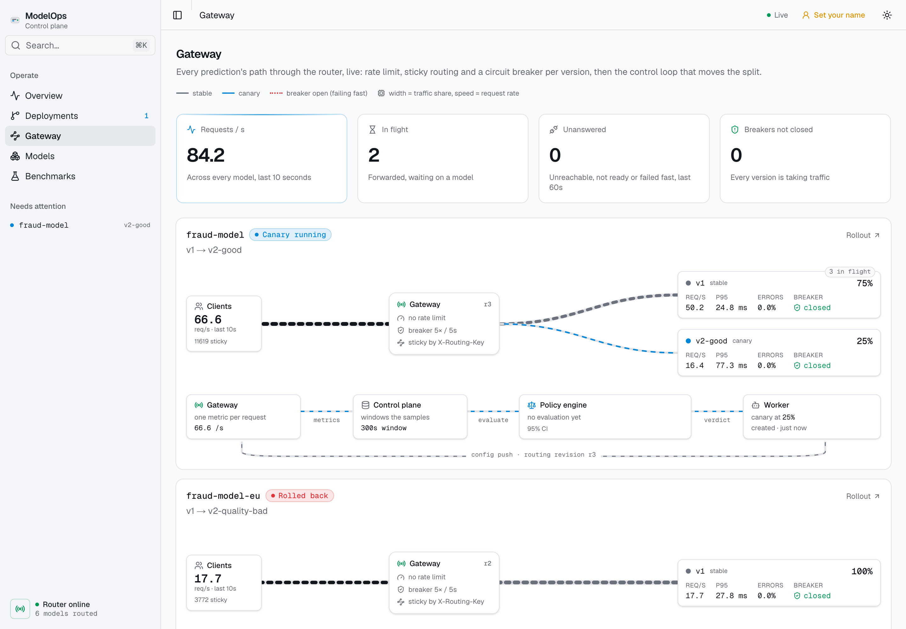

When a canary goes down, its breaker opens after five consecutive failures and
the gateway fails fast (dotted red) instead of waiting on timeouts, until a
half-open probe succeeds.

<p align="center">
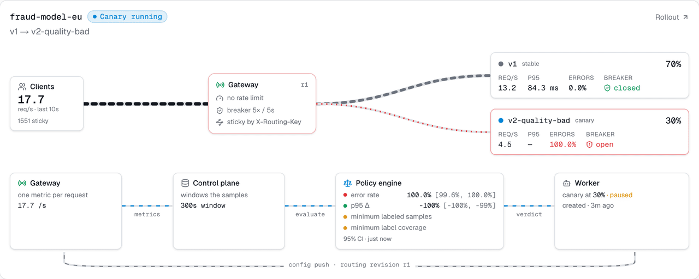
</p>

### A rollback, with its evidence

A canary with 400 ms of injected latency. The chart shows p95 latency and error
rate per version across the rollout, with the traffic steps, the policy limits
and the moment the worker rolled it back.

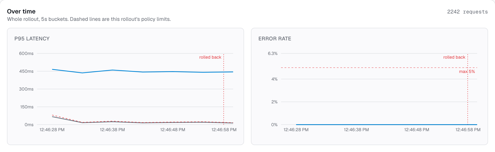

Each policy check stores the interval it measured, not just a verdict. The strip
shows the confidence interval against the limit: entirely past it means **FAIL**,
straddling it means **INCONCLUSIVE**.

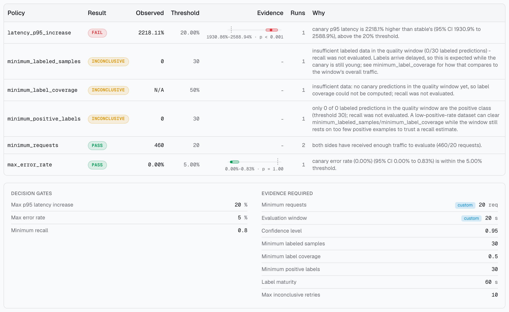

### The timeline

Every state change, worker action and policy result, merged into one story you can
read top to bottom.

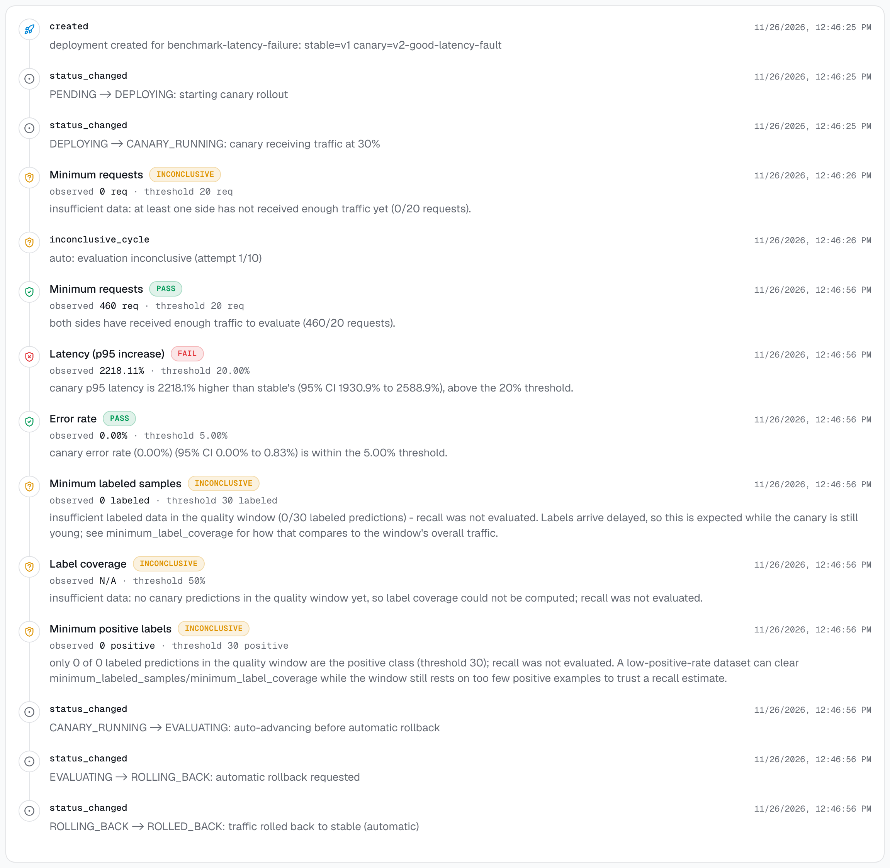

### Live rollout

The traffic split the router actually applied, the canary analysis against stable,
and the operator's controls: pause automation, promote, roll back.

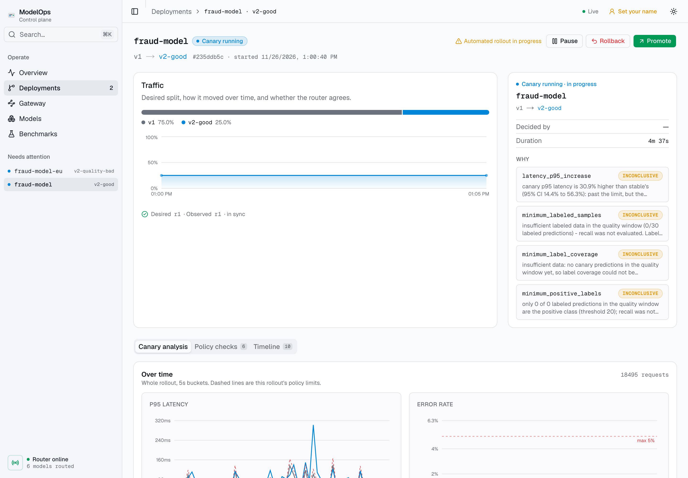

### Benchmarks

Five repeatable end-to-end scenarios, started from the dashboard or the CLI.

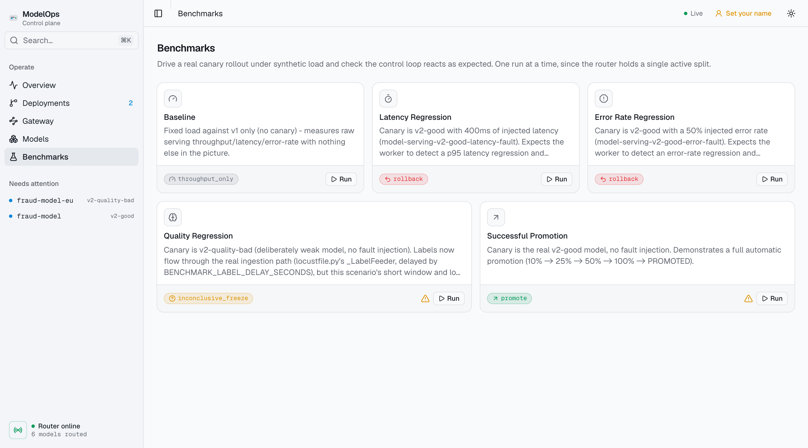

### Grafana and Jaeger

<table>
<tr>
<td width="50%">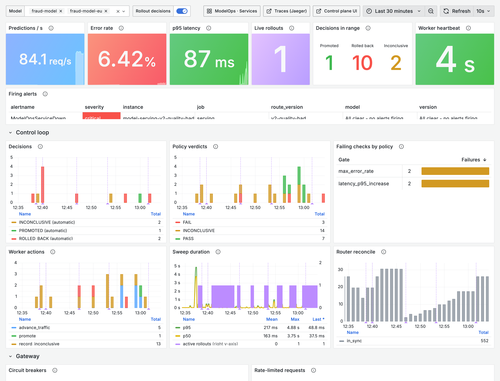</td>
<td width="50%">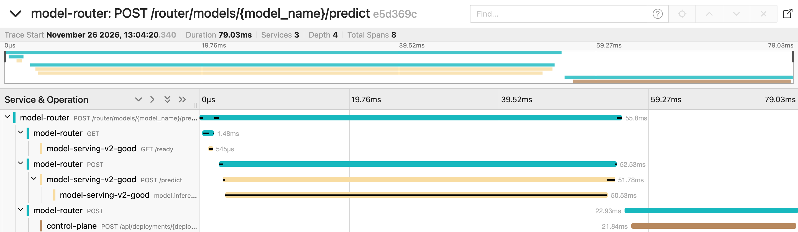</td>
</tr>
<tr>
<td><sub><b>ModelOps · Rollouts</b>: canary vs stable per model, the control loop, circuit breakers, with decisions marked on every graph.</sub></td>
<td><sub>One prediction as a trace: router → readiness check → model service → <code>model.inference</code>.</sub></td>
</tr>
</table>

## How it works

### Architecture

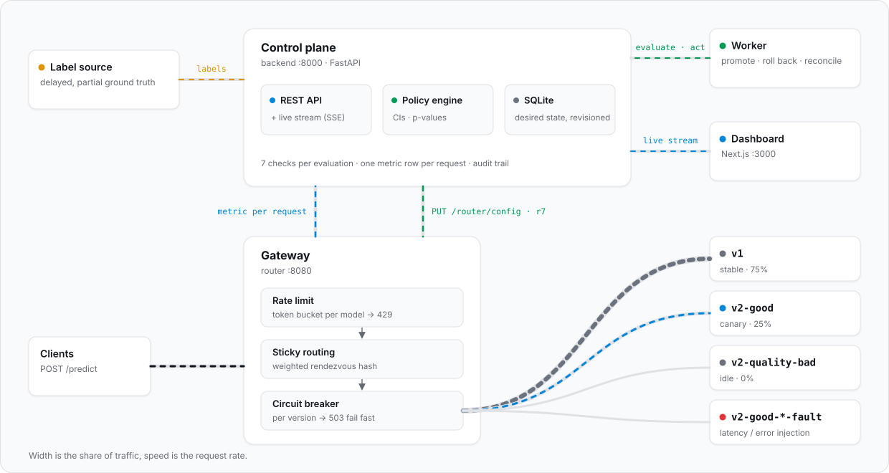

The control plane never talks to a model container, and the router never learns a
host from the control plane: it only receives `version → weight`. Each side can be
restarted, replaced or scaled without the other noticing. See
[DESIGN_NOTES](docs/DESIGN_NOTES.md#traffic-router) for why that boundary matters.

### One request through the gateway

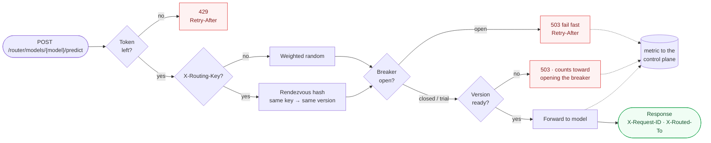

The gateway never quietly sends a request to a different version when one is
down. That would hide a broken canary behind the stable version. A failed request
is answered 503 *and* recorded against the version it was meant for, so a canary
that's down gets rolled back instead of looking idle.

### The control loop

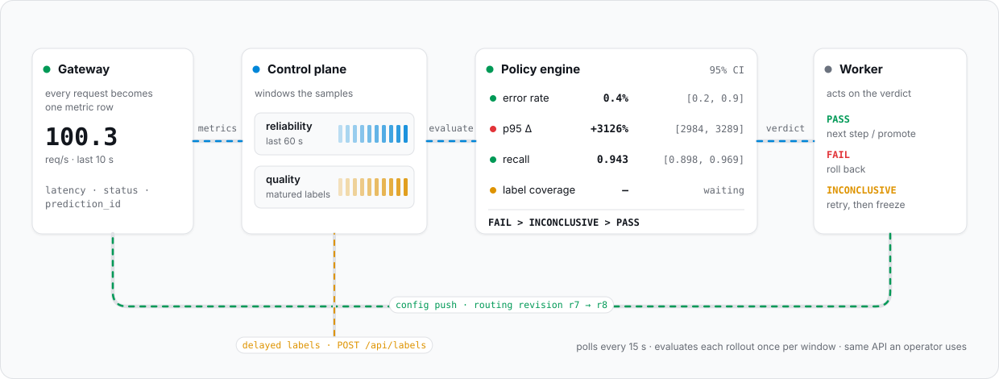

The worker holds no state of its own. It reads everything from the control plane
each cycle and acts only through the same REST endpoints an operator uses, so a
crash or restart loses nothing.

### How one check decides

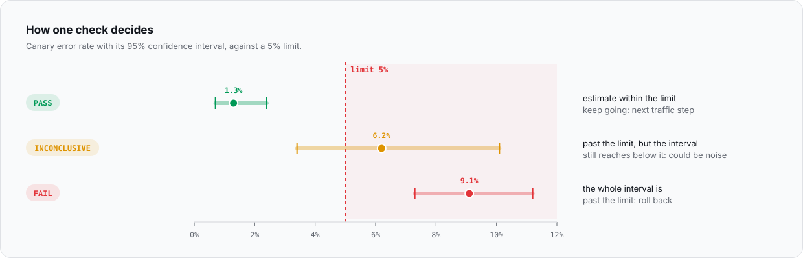

| Check | Measures | Statistics |
|---|---|---|
| `max_error_rate` | Canary 5xx share | Wilson score interval, exact binomial test |
| `latency_p95_increase` | Canary p95 vs stable p95, over successful responses | Bootstrap interval of the p95 ratio, one-sided Mann-Whitney U |
| `minimum_recall` | Recall over matured labels | Wilson score interval, exact binomial test |
| `minimum_requests` | Traffic on both sides | gate |
| `minimum_labeled_samples` · `minimum_label_coverage` · `minimum_positive_labels` | Is there enough ground truth to judge quality? | gates |

The overall verdict is **FAIL > INCONCLUSIVE > PASS**: one failing check rolls the
canary back, one undecided check holds it where it is. Thresholds and the
confidence level (95% by default) are set per rollout.

### Rollout lifecycle

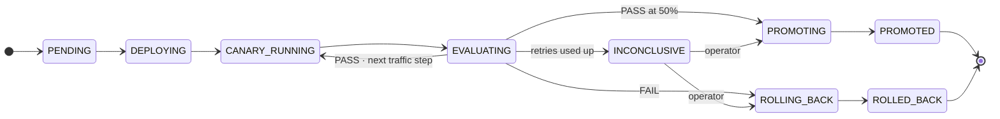

Invalid transitions answer 409. Every transition is a `DeploymentEvent` on the
audit trail, marked `automatic` or `manual` with the operator's name.

### Desired state and observed state

The database is the source of truth for every model's traffic split; each change
gets a new, monotonic revision. The router's in-memory copy is a cache that can be
lost at any time.

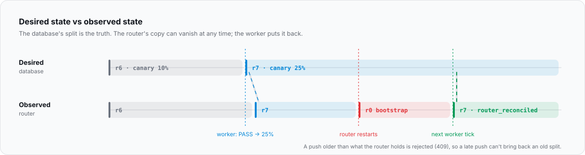

A failed push never fails the rollout: the desired state is already committed, and
the next reconcile tick closes the gap. The router rejects any revision older than
the one it holds, so a delayed push can't bring back an old split. CI proves this by
restarting the real router mid-rollout and waiting for the worker to repair it.

## Quickstart

```bash
make prepare-models   # synthetic dataset, train v1 / v2-good / v2-quality-bad, evaluate
make dev              # docker compose up --build
```

| | |
|---|---|
| Dashboard | http://localhost:3000 |
| Control plane API | http://localhost:8000/docs |
| Gateway | http://localhost:8080/router/health |
| Grafana | http://localhost:3001 |
| Jaeger | http://localhost:16686 |
| Prometheus | http://localhost:9090 |

The database lives on the `backend-db` volume and survives rebuilds;
`docker compose down -v` starts over from an empty one.

<details>
<summary>All services and ports</summary>

| Service | Port | What it is |
|---|---|---|
| `backend` | 8000 | Control plane: deployments, policy, metrics, labels, benchmarks, SSE |
| `frontend` | 3000 | Dashboard (Next.js) |
| `router` | 8080 | Gateway: weighted, sticky routing per model |
| `model-serving-v1` | 8001 | Stable fraud model |
| `model-serving-v2-good` | 8002 | Healthy candidate |
| `model-serving-v2-quality-bad` | 8003 | Deliberately weak model, for the quality scenario |
| `model-serving-v2-good-latency-fault` | 8004 | v2-good with switchable latency injection |
| `model-serving-v2-good-error-fault` | 8005 | v2-good with switchable error injection |
| `worker` | `:9100/metrics` | Promotion, rollback and reconcile loop; no API |
| `grafana` | 3001 | Dashboards and alerts |
| `prometheus` | 9090 | Scrapes every `/metrics`, evaluates alert rules |
| `jaeger` | 16686 | Traces (OTLP on 4318) |

</details>

## Five-minute demo

**1. Watch the platform roll back a bad canary on its own.**

```bash
make benchmark-latency-failure
```

Or open http://localhost:3000/benchmarks and run **Latency Regression**. The
benchmark creates its own rollout, injects 400 ms into the canary and sends ~100
requests per second. Open the **Gateway** page to watch traffic flow, then the
rollout itself: within one or two evaluations the latency check comes back FAIL
with an interval far past the limit, and the worker rolls back.

**2. Watch a good canary get promoted on real (delayed) labels.**

```bash
make benchmark-success
```

Labels arrive 10 s late for 80% of predictions. The quality checks stay
INCONCLUSIVE until enough have matured, then recall passes, and the worker walks the
canary through every traffic step and promotes it.

**3. Run a rollout yourself.**

```bash
curl -s -X POST localhost:8000/api/deployments \
  -H 'Idempotency-Key: demo-1' -H 'content-type: application/json' \
  -d '{"model_name":"fraud-model","stable_version":"v1","canary_version":"v2-good","canary_weight":0.1}'
```

Or use **Start a canary rollout** on the Models page, where you can also tighten
the policy thresholds for this one rollout. Send it traffic with a routing key to see
sticky routing:

```bash
curl -s -X POST localhost:8080/router/models/fraud-model/predict \
  -H 'X-Routing-Key: customer-42' -H 'content-type: application/json' -d @payload.json -i \
  | grep -i '^x-'
```

(`payload.json` is any row of `backend/data/test.csv` as JSON, without
`transaction_id`, `customer_id` and `label`.)

## Benchmarks

Each scenario runs against the real stack with Locust, in its own model name, and
writes `backend/benchmark-results/<scenario>.{json,md}`.

| Scenario | Fault | Expected | Observed | Time to action | Throughput |
| --- | --- | --- | --- | ---: | ---: |
| `baseline` | none, stable only | n/a | 29,871 requests, 0 errors, p95 97 ms | n/a | 99.7 req/s |
| `latency-failure` | +400 ms on canary | rollback | ✅ **ROLLED_BACK** | 30.9 s | 95.6 req/s |
| `error-failure` | 50% 5xx on canary | rollback | ✅ **ROLLED_BACK** | 30.7 s | 99.9 req/s |
| `quality-failure` | weak model (`v2-quality-bad`) | freeze | ✅ **INCONCLUSIVE** (frozen for a human) | 46.3 s | 99.8 req/s |
| `success` | none | promote | ✅ **PROMOTED** (at 50%, then 100%) | 55.9 s | 99.9 req/s |

Time to action is from the rollout starting to the worker's final decision, with
the worker's production 15 s poll interval. The fault containers are switched at
runtime (`PUT /fault-injection`) and always reset afterwards, even if the run
crashes. A run first rolls back anything still holding its own `benchmark-*` model,
so a frozen previous run never blocks the next one.

## Feature reference

<details>
<summary><b>Gateway</b>: sticky routing, circuit breakers, rate limits, request IDs</summary>

- One router serves many models, each with its own split and its own revision
  sequence; a push for one model never touches another's.
- **Sticky routing** by `X-Routing-Key` with weighted rendezvous hashing. Raising
  the canary's weight only moves keys *onto* the canary, never between unrelated
  versions.
- **Circuit breaker per version**, opened by consecutive unreachable or not-ready
  answers (default 5). While open it fails fast with 503 and `Retry-After`; after a
  cooldown one trial request goes through (half-open). It never fails over.
- **Rate limit per model** (token bucket, `ROUTER_RATE_LIMIT_RPS`, off by default),
  answering 429 with `Retry-After`.
- **Request IDs**: `X-Request-ID` is kept or minted and returned, with `X-Routed-To`.
- Readiness is cached for 1 s, so a busy version isn't probed on every request.
- `GET /router/gateway` (and `GET /api/router/gateway` through the control plane):
  rolling 60 s stats per version — rate, p95, outcomes, in-flight, breaker state.

</details>

<details>
<summary><b>Policy engine</b>: seven checks, two windows, confidence intervals</summary>

- Reliability checks read the most recent window; quality checks read an older,
  *matured* window, because labels arrive late.
- `minimum_positive_labels` exists because recall's denominator is positive
  examples: at a 2% fraud rate a window can hold hundreds of labels and only two
  frauds.
- Every result is a `PolicyEvaluation` row with the observed value, the limit, the
  interval, the p-value, the method and an explanation.
- `POST /api/deployments/{id}/evaluate`, `GET .../policy-evaluations`,
  `GET /api/policy/defaults`. Thresholds can be overridden per rollout
  (`policy_config` on create).

Design notes: [Policy engine](docs/DESIGN_NOTES.md#policy-engine).

</details>

<details>
<summary><b>Automation</b>: the worker, manual holds, operator actions</summary>

- **PASS** → next traffic step, or promote once the canary is at 50%. **FAIL** → roll back.
  **INCONCLUSIVE** → retry up to `max_inconclusive_retries`, then freeze.
- `POST /api/deployments/{id}/pause-automation` and `/resume-automation` take one
  rollout out of the worker's hands without stopping the worker for everyone else;
  manual promote and rollback still work.
- Manual actions carry an `X-Operator` header (set from the dashboard's header);
  the name lands on the audit trail. It's an audit hint, not authentication.

Design notes: [Automated promotion & rollback](docs/DESIGN_NOTES.md#automated-promotion--rollback),
[Manual automation hold](docs/DESIGN_NOTES.md#manual-automation-hold).

</details>

<details>
<summary><b>Ground-truth labels</b>: delayed, partial, idempotent</summary>

- `prediction_id` is minted once by the model service and carried through the
  gateway into the metric row: the key a late label uses to find its prediction.
- `POST /api/labels` and `/api/labels/batch`: idempotent (200 on a repeat),
  conflict-detecting (409 and an audit event for a different label), and tolerant
  of arriving before the metric (202, stored and joined later).
- The benchmark load generator labels its own requests, late and for only 80% of
  them, through this same API. Nothing writes labels into the database directly.

Design notes: [Label ingestion](docs/DESIGN_NOTES.md#label-ingestion).

</details>

<details>
<summary><b>Dashboard</b>: pages and live updates</summary>

- **Overview**, **Deployments** (list and rollout detail), **Gateway**, **Models**
  (versions, evaluations and the rollout form with policy thresholds),
  **Benchmarks**, and a ⌘K command palette.
- **Live**: `GET /api/stream` is a Server-Sent Events feed of new events and policy
  results; the dashboard refetches exactly what changed and falls back to polling
  if the stream drops.
- `GET /api/fleet/summary` (outcomes, who decided, automation rate, median time to
  decision) and `GET /api/deployments/{id}/metrics/timeseries` (the Over time chart).
- API types are generated from the control plane's OpenAPI schema
  (`npm run gen:api`); CI fails if they drift.

</details>

<details>
<summary><b>Observability</b>: metrics, dashboards, alerts, traces</summary>

- Every service exports Prometheus metrics at `/metrics`: requests and latency per
  route, routed predictions and upstream latency per model and version, the applied
  split, breaker state, rate-limited requests, decisions, policy verdicts, reconcile
  results, worker sweeps and heartbeat.
- **Grafana** (no login): *ModelOps · Rollouts* (headline numbers, control loop,
  gateway, canary vs stable per model) and *ModelOps · Services*.
- **Alerts** (`observability/prometheus/rules.yml`): service down, worker stalled,
  error rate or p95 too high, reconcile failing.
- **Traces** in Jaeger: router → readiness → model `/predict` → `model.inference`,
  and worker sweep → evaluate → promote/rollback → router push.

Details: [observability/README.md](observability/README.md).

</details>

<details>
<summary><b>API at a glance</b></summary>

| Endpoint | |
|---|---|
| `POST /api/deployments` | Start a rollout (`Idempotency-Key` supported) |
| `GET /api/deployments[/{id}]` | List / read, with events and the applied split |
| `POST /api/deployments/{id}/evaluate` | Run every policy check now |
| `POST /api/deployments/{id}/promote` · `/rollback` | Operator decisions |
| `POST /api/deployments/{id}/pause-automation` · `/resume-automation` | Manual hold |
| `GET /api/deployments/{id}/timeline` | Events and policy results, oldest first |
| `GET /api/deployments/{id}/metrics?window_seconds=300` | p50/p95/p99, errors, precision/recall, label coverage |
| `GET /api/deployments/{id}/metrics/timeseries` | Per-version series across the rollout |
| `POST /api/labels` · `/api/labels/batch` | Ground truth |
| `POST /api/router/reconcile` · `GET /api/router/observed` | Desired vs observed |
| `GET /api/router/gateway` | Live gateway stats |
| `GET /api/stream` | Server-Sent Events |
| `POST /api/benchmarks/run` · `GET /api/benchmarks/current` | Dashboard benchmarks |

Full schema: http://localhost:8000/docs.

</details>

## Development

```bash
make test                 # backend tests (pytest)
make lint                 # ruff + mypy --strict, eslint + tsc
make e2e                  # Playwright against the running stack
make ci-smoke-test        # the real-stack scenarios CI runs
make check-observability  # targets scraped, alerts and dashboards loaded, traces arriving
make dashboards           # regenerate the Grafana JSON from its generator
cd frontend && npm run gen:api   # regenerate the dashboard's API types
```

CI runs four jobs on every push:

| Job | What it checks |
|---|---|
| `backend` | ruff, `mypy --strict`, 359 pytest tests |
| `frontend` | eslint, `tsc --noEmit`, `next build` |
| `api-contract` | Regenerates the OpenAPI schema and TypeScript types and fails on any diff (FastAPI and pydantic pinned in `backend/constraints-api-contract.txt`) |
| `integration` | Boots the **real** stack and runs six scenarios against it, the observability check and the Playwright suite |

The integration scenarios use the real worker, not a stand-in:

1. manual create → evaluate → promote;
2. injected latency, detected and rolled back by the worker;
3. a healthy canary walked through every traffic step and promoted on a real recall PASS;
4. a weak canary rolled back on a real recall FAIL;
5. `docker compose restart router` mid-rollout, repaired by the worker's reconcile tick;
6. a router restart after promotion, restored by the router's own startup sync.

Every real bug in this project was found by running the actual stack, which is why
that job exists.

<details>
<summary>Project layout</summary>

```
backend/
  app/
    control_plane/   deployments, traffic allocation, metrics, labels, SSE, reconcile
    policy/          checks, statistics (stats.py), explanations
    worker/          promotion / rollback / reconcile loop
    router/          gateway: routing, breaker, rate limit, telemetry
    serving/         one model version per process, fault injection
    benchmarks/      dashboard-triggered benchmark runs
    observability/   Prometheus and OpenTelemetry setup
  scripts/           dataset, training, benchmarks (Locust), CI smoke test
  alembic/           migrations (run at startup)
frontend/
  src/app/           pages: overview, deployments, gateway, models, benchmarks
  src/components/    UI and the animated flow / chart components
  e2e/               Playwright tests
observability/       Prometheus rules, Grafana dashboards and their generator
docs/DESIGN_NOTES.md the why behind each design decision
```

</details>

<details>
<summary>Resource footprint</summary>

Measured with `docker stats` on an Apple Silicon MacBook (native arm64 images):

| Service | RSS |
|---|---|
| `frontend` (Next.js dev server) | ~1.0 GiB |
| 5× `model-serving-*` | ~165 MiB each |
| `backend` | ~99 MiB |
| `router` | ~66 MiB |
| `worker` | ~32 MiB |
| **All 9 ModelOps containers** | **~2.0 GiB** |

The frontend is the biggest consumer because `make dev` runs `next dev` with hot
reload.

</details>

## Known limitations

- **Labels are real API traffic, but synthetic data.** Ground truth flows late and
  partial through `POST /api/labels`, but its source is the synthetic dataset's known
  labels, not a production feedback loop.
- **Quality scenarios are stratified.** CI and the `success` benchmark send 30–50%
  fraud cases, so a short window holds enough positives for recall to be a
  measurement rather than noise. The demo load uses the natural ~2% rate.
- **Single router, periodic reconcile.** Drift is closed on the next worker cycle
  (15 s by default), and the reconciler assumes one router instance.
- **A frozen rollout blocks its model.** An INCONCLUSIVE rollout still counts as
  active until someone promotes or rolls it back (the benchmark runner does this for
  its own models).
- **Local-only observability.** Grafana has no login, Jaeger keeps traces in memory,
  and there's no Alertmanager, so alerts show in Grafana but notify no one.
- **`--reload` in development.** Saving a file under `backend/app` or
  `backend/scripts` during a dashboard benchmark restarts the control plane and ends
  the run; it's marked FAILED ("interrupted") on the next start.
- **A deployment created at 100% canary** leaves stable with no traffic, so
  `minimum_requests` can't be met; the timeline says so explicitly. The automated
  ramp avoids this by promoting at 50%, while both sides still serve real traffic.

More on what was deliberately left out: [Future vision](docs/DESIGN_NOTES.md#future-vision).

## Production evolution

| Today | In production | Why |
|---|---|---|
| SQLite | PostgreSQL | One writer at a time is fine for one process; replicas need real concurrency, pooling and point-in-time recovery. |
| One worker | Several workers with leader election or row locks | A single worker is a single point of failure; several need mutual exclusion per rollout. |
| Gateway posts metrics over HTTP | Kafka or another event stream | Decouples the hot path from the control plane's availability and lets several consumers read the same stream. |
| Docker Compose | Kubernetes | Rolling restarts, autoscaling, multi-node scheduling, mTLS. |
| Local model directory | Object storage + a model registry | Shared, versioned, survives the machine. |
| No auth | OIDC + RBAC | "Can view" and "can promote to 100%" are different permissions; the audit trail is already there. |

## Troubleshooting

<details>
<summary>Real problems hit while building this, and their fixes</summary>

- **Timestamps hours off.** SQLite doesn't enforce `DateTime(timezone=True)`, so UTC
  values can come back without an offset. Parse API timestamps with `parseApiDate`
  (frontend) or `parse_timestamp` (benchmarks), never `new Date()` /
  `datetime.fromisoformat` directly.
- **Worker died during a control-plane restart.** A connection error escaped the
  sweep; the loop now logs it and retries next cycle. The worker keeps no state, so
  nothing is lost.
- **`make benchmark-*` exited non-zero on a "successful" failure scenario.** Locust
  fails on any failed request by default, which is the point of a fault scenario.
  The runner uses `--exit-code-on-error 0` and compares the observed outcome
  instead.
- **Backend reload hung for minutes.** A folded YAML `command:` with deeper-indented
  continuation lines kept its newlines, so `--timeout-graceful-shutdown` ran as a
  separate shell command and open SSE connections held the reload until their
  300 s limit.
- **A benchmark failed with 409.** A previous run of the same scenario was frozen
  INCONCLUSIVE. The runner now rolls back its own stale rollout first.
- **`git push` rejected with GH007.** GitHub's private-email setting checks both
  author and committer; set both to the `@users.noreply.github.com` address.

</details>

---

<div align="center"><sub>MIT licensed · design rationale in <a href="docs/DESIGN_NOTES.md">docs/DESIGN_NOTES.md</a></sub></div>
